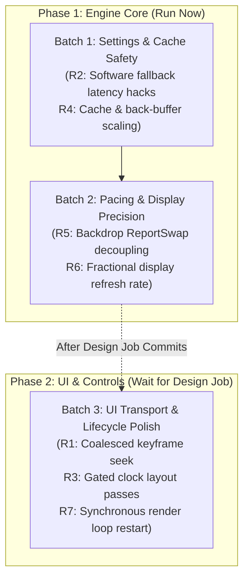

# Pass 7 Implementation Fix Plans (Roadmap Task 7.25)

This document provides the verification analysis, code reading confirmations, and detailed implementation plans for the approved Pass 7 review findings **R1 through R7** (findings R8–R11 were declined).

---

## 1. Executive Summary & Verification Matrix

All 7 findings have been examined directly against the codebase. Every finding is confirmed by code reading, with refinements noted for seek coalescing semantics, back-buffer clamping, and render thread shutdown synchronization.

| # | Finding Title | Code Reading Status | Component Scope | Design Job Conflict | Can Run Now? |
|:---|:---|:---:|:---:|:---:|:---:|
| **R1** | Uncoalesced `relative+exact` seek on 5 s skip buttons/keys | **Confirmed** | Playback Core / Transport | Waits (touches `MainPage.Transport.cs`) | ⏳ Wait |
| **R2** | `video-latency-hacks` active during software decoding fallback | **Confirmed** | Playback Settings Core | Engine-only | ✅ **Yes** |
| **R3** | Per-frame XAML layout & clock string allocations with hidden OSD | **Confirmed** | App Shell / UI Controls | Waits (touches `MainPage.xaml.cs`) | ⏳ Wait |
| **R4** | Hardcoded 512MiB back-buffer overrides `NetworkCacheMegabytes` | **Confirmed** | Interop / Playback Settings | Engine-only | ✅ **Yes** |
| **R5** | `BackdropSource.NeedsFrame` forces continuous redraws & false `ReportSwap` | **Confirmed** | Render Loop Core | Engine-only | ✅ **Yes** |
| **R6** | Integer refresh rate detection truncates fractional Hz (59.94 / 119.88) | **Confirmed** | Windowing Interop / Sync | Engine-only | ✅ **Yes** |
| **R7** | Non-blocking loop disposal in `RestartLoop` triggers 100 ms retry stall | **Confirmed** | Controls / Render Surface | Waits (touches `Controls/MpvVideoSurface.cs`) | ⏳ Wait |

---

## 2. Detailed Findings Verification & Implementation Plans

### R1: Uncoalesced `relative+exact` seek on 5 s skip buttons and arrow keys

- **Exact File & Member:**
  - `src/Aether.Core.Playback/TransportState.cs` &mdash; `TransportState.SeekBy(double seconds)`
  - `src/Aether.App/Playback/PlayerSession.cs` &mdash; `PlayerSession.SeekBy(double seconds)`
  - `src/Aether.App/MainPage.Transport.cs` &mdash; `MainPage.SkipBy(double seconds)`, `OnBackAccelerator`, `OnForwardAccelerator`
- **Verification Status:** **Confirmed**.
  - `TransportState.SeekBy` hardcodes `"relative+exact"`, which forces mpv to decode sequentially from the nearest keyframe to the exact timestamp.
  - `PlayerSession.SeekBy` fires `_context.CommandAsync(TransportState.SeekBy(seconds))` directly, completely bypassing `SeekCoalescer`. Holding an arrow key fires keyboard accelerators at 30–60 Hz, flooding mpv with overlapping exact seek requests and causing GOP decoding pipeline stalls.
- **Correction / Refinements:**
  - `TransportState.SeekBy` should use `"relative+default"` (or `"relative+keyframes"` when `PreciseSeeking` is off), allowing mpv to respect the configured `hr-seek` property already mapped from `AetherSettings.PreciseSeeking`.
  - For rapid key repeats, `SeekCoalescer` currently only supports absolute `Seek(double seconds, bool dragging)`. We should extend `SeekCoalescer` with relative seek accumulation (e.g., `SeekBy(double deltaSeconds)`), so multiple rapid arrow key events collapse into a single pending delta while a seek is in flight.
- **Smallest Change:**
  1. In `TransportState.SeekBy`, change the third parameter from `"relative+exact"` to `"relative+default"` (or `"relative+keyframes"`).
  2. In `SeekCoalescer`, add `SeekBy(double deltaSeconds)` to accumulate pending relative offsets when a seek is already in flight.
  3. In `PlayerSession.SeekBy`, route the skip request through `SeekCoalescer.SeekBy`.
- **Files Touched:**
  - `src/Aether.Core.Playback/TransportState.cs`
  - `src/Aether.Core.Playback/SeekCoalescer.cs`
  - `src/Aether.App/Playback/PlayerSession.cs`
  - (Optional: `src/Aether.App/MainPage.Transport.cs` if rate-limiting is applied at the accelerator level).
- **Existing Tests:**
  - `tests/Aether.Core.Tests/TransportStateTests.cs`
  - `tests/Aether.Core.Tests/SeekCoalescerTests.cs`
- **New Tests to Add (in `Aether.Core.Playback`):**
  - Unit tests in `TransportStateTests` verifying `SeekBy` emits `"relative+default"`.
  - Unit tests in `SeekCoalescerTests` verifying that calling `SeekBy` while a command is in-flight accumulates deltas and dispatches the accumulated skip on reply.
- **Risk:** Low. Granularity shifts to nearest keyframes (~0.5–2 s) when `PreciseSeeking` is disabled, which matches standard desktop player behavior (VLC, MPC-HC).
- **Hardware Measurement:**
  - Task 7.10 matrix M5/M6: Monitor seek latency (ms) and dropped frame burst during 5 consecutive 5 s skips (`→`) on a 1080p60/4K24 video with a 10 s GOP interval. Verify zero audio dropouts and near-instant visual updates.
- **Design Job Conflict:** **Waits**. Touches `MainPage.Transport.cs` if modified at the accelerator dispatch level; core engine pieces can be built independently, but full integration waits for `MainPage*`.

---

### R2: `video-latency-hacks` active during software decoding fallback under `auto-safe`

- **Exact File & Member:**
  - `src/Aether.Core.Playback/Settings/MpvSettingsMap.cs` &mdash; `MpvSettingsMap.VideoLatencyHacks(AetherSettings settings)`
  - `tests/Aether.Core.Tests/MpvSettingsMapTests.cs` &mdash; `Software_Decoding_Keeps_The_Frame_Decoded_Ahead`
- **Verification Status:** **Confirmed**.
  - `MpvSettingsMap.VideoLatencyHacks` returns `settings.HardwareDecoding != "no"`.
  - Because `HardwareDecoding` defaults to `"auto-safe"`, latency hacks are enabled (`yes`) at mpv startup. When a file fails hardware decode (e.g., 10-bit H.264, Hi10P, or unsupported AV1/VP9 profiles), mpv silently falls back to software decode. Because `video-latency-hacks` remains active, the CPU decoder loses its 1-frame readahead queue, causing stutter and frame drops on complex frames.
- **Correction / Refinements:**
  - `VideoLatencyHacks` should be restricted to explicit hardware decoding modes: `settings.HardwareDecoding is "d3d11va" or "d3d11va-copy"`. For `"auto-safe"` and `"no"`, it should return `false`.
  - The existing test `Software_Decoding_Keeps_The_Frame_Decoded_Ahead` in `MpvSettingsMapTests.cs` asserted `[InlineData("auto-safe", true)]` and must be updated to `[InlineData("auto-safe", false)]`.
- **Smallest Change:**
  1. Change `MpvSettingsMap.VideoLatencyHacks` to:
     ```csharp
     public static bool VideoLatencyHacks(AetherSettings settings)
     {
         ArgumentNullException.ThrowIfNull(settings);
         return settings.HardwareDecoding is "d3d11va" or "d3d11va-copy";
     }
     ```
  2. Update the xUnit theory test in `MpvSettingsMapTests.cs`.
- **Files Touched:**
  - `src/Aether.Core.Playback/Settings/MpvSettingsMap.cs`
  - `tests/Aether.Core.Tests/MpvSettingsMapTests.cs`
- **Existing Tests:**
  - `tests/Aether.Core.Tests/MpvSettingsMapTests.cs`
  - `tests/Aether.Core.Tests/HardwareDecodeFallbackTests.cs`
- **New Tests to Add (in `Aether.Core.Playback`):**
  - Verify that `VideoLatencyHacks` returns `false` for `"auto-safe"` and `"no"`, and `true` for `"d3d11va"` and `"d3d11va-copy"`.
- **Risk:** Extremely low. Adds at most 1 frame of latency (~8 ms at 120 fps, ~16 ms at 60 fps) when hardware decoding succeeds under `auto-safe`, but protects software decoding fallback completely.
- **Hardware Measurement:**
  - Task 7.10 matrix M3/M4: Play a 10-bit H.264 clip under `auto-safe` (triggering software fallback); observe `decoder-frame-drop-count` in Diagnostics panel (`Ctrl+I`). It should remain 0.
- **Design Job Conflict:** **Engine-only**. Does not touch `MainPage*`, `MainWindow`, or `DesignTokens`. Can run **now**.

---

### R3: Per-frame XAML layout passes and clock string allocations while OSD chrome is completely hidden

- **Exact File & Member:**
  - `src/Aether.App/MainPage.xaml.cs` &mdash; `OnViewModelChanged(object? sender, PropertyChangedEventArgs e)`, `UpdateClock(PlayerViewModel vm)`, `ApplyChrome()`
  - `src/Aether.App/Controls/PrecisionSeekBar.xaml.cs` &mdash; `Position` setter, `ArrangeProgress()`
- **Verification Status:** **Confirmed**.
  - In `MainPage.xaml.cs`, property change notifications for `Position` fire on every video frame (up to 120/240 Hz).
  - `UpdateClock` unconditionally allocates duration and position strings via `Timecode.FormatClock`, syncs clip ranges, and updates `SeekBar.Position`, which invalidates XAML element layout via `ArrangeProgress()` (`Canvas.SetLeft(Thumb)` and `Played.Width`).
  - This work occurs continuously while `_chromeShown == false`, causing unnecessary UI thread churn and garbage collection while watching fullscreen video undisturbed.
- **Correction / Refinements:**
  - When chrome is hidden (`!_chrome.IsVisible`), skip updating `PositionText`, `DurationText`, and `SeekBar`.
  - When chrome transitions from hidden back to visible (`ApplyChrome()`), immediately invoke `UpdateClock` so the controls show the current position without a 1-second lag.
  - Duration string formatting (`DurationText.Text`) should only re-evaluate when `vm.Duration` actually changes, not on every frame tick.
- **Smallest Change:**
  1. In `MainPage.xaml.cs`, inside `OnViewModelChanged` for `nameof(PlayerViewModel.Position)`:
     ```csharp
     case nameof(PlayerViewModel.Position):
         if (_chrome.IsVisible)
         {
             UpdateClock(vm);
         }
         break;
     ```
  2. In `ApplyChrome()`, when `visible && !_chromeShown`, call `UpdateClock(_session.ViewModel)` prior to fading in.
  3. Cache formatted duration in a field `_formattedDuration` and update it only on `Duration` property change.
- **Files Touched:**
  - `src/Aether.App/MainPage.xaml.cs`
- **Existing Tests:**
  - `tests/Aether.Core.Tests/PlayerViewModelTests.cs`
  - `tests/Aether.Core.Tests/TransportPillTests.cs`
- **New Tests to Add (in `Aether.Core.Playback`):**
  - Extract gating/formatting logic into a testable pure state struct/class in `Aether.Core.Playback` (e.g., `ClockDisplayFilter`) to verify that hidden states suppress updates and visibility transitions trigger immediate refresh.
- **Risk:** Low. Must ensure seek bar thumb and timecodes never display stale positions upon unhiding the OSD.
- **Hardware Measurement:**
  - Monitor UI thread CPU usage and Gen 0 GC collections in Visual Studio Profiler or PerfView during 60 s of 4K 120 fps playback with OSD hidden.
- **Design Job Conflict:** **Waits**. Touches `MainPage.xaml.cs`. Must wait until the active design job on `MainPage*` is committed.

---

### R4: Hardcoded 512MiB `demuxer-max-back-bytes` overrides and nullifies `NetworkCacheMegabytes` setting

- **Exact File & Member:**
  - `src/Aether.Core.Interop/Mpv/MpvContext.cs` &mdash; `MpvContextOptions.BackBufferSize`, `MpvContext.BuildOptions`
  - `src/Aether.Core.Playback/Settings/MpvSettingsMap.cs` &mdash; `MpvSettingsMap.StartOptions(AetherSettings settings)`
  - `src/Aether.App/Playback/PlayerSession.cs` &mdash; `CreateContext`
- **Verification Status:** **Confirmed**.
  - `MpvContextOptions.BackBufferSize` is hardcoded to `"512MiB"`.
  - In libmpv, `demuxer-max-bytes` is automatically increased to match `demuxer-max-back-bytes` if `demuxer-max-back-bytes > demuxer-max-bytes`.
  - The user setting `NetworkCacheMegabytes` defaults to 150 MiB (slider range 16–2048 MiB). Any setting below 512 MiB is silently overridden by mpv to at least 512 MiB, breaking low-memory constraints.
- **Correction / Refinements:**
  - The demuxer back-buffer should scale proportionally with `settings.NetworkCacheMegabytes`.
  - In `MpvSettingsMap.StartOptions`, emit both `demuxer-max-bytes` and `demuxer-max-back-bytes`. For instance, allocate up to half of the total cache to backward scrubbing: `backBytes = Math.Clamp(settings.NetworkCacheMegabytes / 2, 8, 512)`.
  - Because `AdditionalOptions` in `MpvContext.BuildOptions` are appended after defaults, emitting `demuxer-max-back-bytes` in `StartOptions` naturally overrides the default.
- **Smallest Change:**
  1. In `MpvSettingsMap.StartOptions`:
     ```csharp
     int cacheMb = settings.NetworkCacheMegabytes;
     int backMb = Math.Clamp(cacheMb / 2, 8, 512);
     options.Add(new("demuxer-max-bytes", $"{cacheMb.ToString(CultureInfo.InvariantCulture)}MiB"));
     options.Add(new("demuxer-max-back-bytes", $"{backMb.ToString(CultureInfo.InvariantCulture)}MiB"));
     ```
- **Files Touched:**
  - `src/Aether.Core.Playback/Settings/MpvSettingsMap.cs`
- **Existing Tests:**
  - `tests/Aether.Core.Tests/MpvSettingsMapTests.cs`
  - `tests/Aether.Core.Tests/MpvContextTests.cs`
- **New Tests to Add (in `Aether.Core.Playback`):**
  - Add unit tests in `MpvSettingsMapTests` testing `NetworkCacheMegabytes` values (e.g. 16, 64, 150, 512, 1024, 2048) and verifying that `demuxer-max-bytes` and `demuxer-max-back-bytes` maintain proper proportions and bounds.
- **Risk:** Low. Reduces backward seek cache when small cache sizes are explicitly requested by the user.
- **Hardware Measurement:**
  - Set `NetworkCacheMegabytes` to 64 MiB. Stream or play a media file and verify in Task Manager / VMMap that process working set and private bytes stay near ~64–100 MiB rather than expanding to 550+ MiB.
- **Design Job Conflict:** **Engine-only**. Touches only `Aether.Core.Playback`. Can run **now**.

---

### R5: `BackdropSource.NeedsFrame` forces continuous redraws and `ReportSwap` at display refresh rate during UI fades

- **Exact File & Member:**
  - `src/Aether.Core.Interop/Rendering/MpvRenderLoop.cs` &mdash; lines 257–295 (`Run()`)
  - `src/Aether.Core.Interop/Rendering/AngleMpvRenderBackend.cs` &mdash; `PollFrame()`, `Render()`, `ReportSwap()`
- **Verification Status:** **Confirmed**.
  - During a UI fade (300 ms), `BackdropSource.NeedsFrame` returns `true`, setting `force = true` in `MpvRenderLoop`.
  - While `force == true`, the loop bypasses `WaitForWork()` and renders every VBlank tick.
  - When `backend.PollFrame()` returns `false` (no new video frame), the loop still calls `backend.Render(...)`, `presenter.Present(...)`, and unconditionally calls `backend.ReportSwap()`.
  - Calling `mpv_render_context_report_swap` when no new frame was produced falsely notifies mpv's pacing engine that a video frame was presented, disrupting `video-sync=display-resample` calculations and causing micro-stutter.
- **Correction / Refinements:**
  - Decouple `backend.ReportSwap()` from backdrop redraws. Only call `backend.ReportSwap()` when `frame == true` (mpv actually supplied a frame).
  - Presentation (`presenter.Present`) still runs so the backdrop fade animates smoothly, but mpv is not misinformed about false video frame presentations.
- **Smallest Change:**
  1. In `MpvRenderLoop.Run()`, change swap reporting to:
     ```csharp
     else if (presenter.Present(_options.VSync) != PresentResult.DeviceLost)
     {
         if (frame)
         {
             backend.ReportSwap();
         }
         Interlocked.Increment(ref _framesPresented);
         force = _options.Backdrop?.NeedsFrame == true;
     }
     ```
- **Files Touched:**
  - `src/Aether.Core.Interop/Rendering/MpvRenderLoop.cs`
- **Existing Tests:**
  - `tests/Aether.Core.Tests/MpvRenderLoopTests.cs`
  - `tests/Aether.Core.Tests/BackdropBlurPassTests.cs`
- **New Tests to Add (in `Aether.Core.Playback` / `Aether.Core.Tests`):**
  - Unit test in `MpvRenderLoopTests` with a mock backend verifying that when `PollFrame()` returns `false` and a forced redraw is triggered, `Render()` is called but `ReportSwap()` is skipped.
- **Risk:** Low. Adheres strictly to the libmpv render API contract (`render.h`), which states `report_swap` should only be called if a frame was rendered and presented.
- **Hardware Measurement:**
  - Task 7.10 matrix M1 vs M2: Play a 24 fps clip on a 144 Hz display with `video-sync=display-resample`. Repeatedly trigger OSD fades by moving the cursor across the window. Check `frame-drop-count` and audio resample ratio in Diagnostics (`Ctrl+I`); verify zero dropped frames.
- **Design Job Conflict:** **Engine-only**. Touches only `Aether.Core.Interop`. Can run **now**.

---

### R6: Integer display refresh rate detection truncates fractional Hz (59.94 / 119.88 Hz), causing periodic frame drops

- **Exact File & Member:**
  - `src/Aether.Core.Interop/Windowing/DisplayRefresh.cs` &mdash; `DisplayRefresh.QueryHertz(nint monitor)`
  - `src/Aether.Core.Playback/DisplayRefreshTracker.cs` &mdash; `DisplayRefreshTracker.Format(int hertz)`, `Accept(nint monitor, int hertz)`
  - `src/Aether.App/Playback/DisplayRefreshSync.cs` &mdash; `Refresh(bool displayChanged)`
- **Verification Status:** **Confirmed**.
  - `DisplayRefresh.QueryHertz` calls `EnumDisplaySettingsW`, which fills `DEVMODEW.dmDisplayFrequency` as an integer DWORD.
  - On standard 59.940 Hz or 119.880 Hz displays, this returns `59` or `60` (or `119`/`120`).
  - When `display-fps-override=60` is passed to mpv for a 59.940 Hz monitor, `video-sync=display-resample` plans timing against 60.000 Hz, leading to 1 dropped or duplicated frame every ~16.7 seconds (~1000 frames).
- **Correction / Refinements:**
  - Windows provides exact rational refresh rates via the Connecting and Configuring Displays (CCD) API: `GetDisplayConfigBufferSizes` and `QueryDisplayConfig(QDC_ONLY_SPECIFIED, ...)`.
  - Each path contains `targetInfo.refreshRate.Numerator` and `Denominator` (`DISPLAYCONFIG_RATIONAL`).
  - For standard modes, `60000 / 1001` evaluates to `59.940059... Hz`.
  - `DisplayRefresh` should attempt `QueryDisplayConfig` first to retrieve the exact fractional rate, falling back to `EnumDisplaySettingsW` if CCD fails.
  - `DisplayRefreshTracker` should format rational or floating-point refresh rates to invariant culture strings (e.g. `"59.94"` or `"119.88"`).
- **Smallest Change:**
  1. Add P/Invoke definitions for `QueryDisplayConfig` and CCD structures in `User32.cs` / `DisplayConfigNative.cs`.
  2. In `DisplayRefresh.cs`, add `QueryRationalRefreshRate(nint monitor, out double hertz)`.
  3. In `DisplayRefreshTracker.cs`, update `Accept` and `Format` to support `double` refresh rates formatted with `"0.###"` invariant culture.
  4. In `DisplayRefreshSync.cs`, pass the exact rate to `_tracker.Accept`.
- **Files Touched:**
  - `src/Aether.Core.Interop/Native/User32.cs` (or `DisplayConfigNative.cs`)
  - `src/Aether.Core.Interop/Windowing/DisplayRefresh.cs`
  - `src/Aether.Core.Playback/DisplayRefreshTracker.cs`
  - `src/Aether.App/Playback/DisplayRefreshSync.cs`
- **Existing Tests:**
  - `tests/Aether.Core.Tests/DisplayRefreshTrackerTests.cs`
- **New Tests to Add (in `Aether.Core.Playback`):**
  - Unit tests in `DisplayRefreshTrackerTests` for fractional inputs:
    - `59.940` -> `"59.94"`
    - `119.880` -> `"119.88"`
    - `60.0` -> `"60"`
    - Clamping validation for rates <10 Hz or >1000 Hz.
- **Risk:** Medium (Size M). Requires robust fallback to `EnumDisplaySettingsW` in virtual machines, remote desktop sessions, or driver environments where CCD queries might return error codes.
- **Hardware Measurement:**
  - Connect a 59.94 Hz or 119.88 Hz display. Play a 23.976 fps video for 5 minutes under `video-sync=display-resample`. Verify in the Diagnostics panel (`Ctrl+I`) that `frame-drop-count` remains 0.
- **Design Job Conflict:** **Engine-only**. Touches `Aether.Core.Interop`, `Aether.Core.Playback`, and `Aether.App/Playback`. Can run **now**.

---

### R7: Non-blocking loop disposal in `RestartLoop` triggers race conditions and 100 ms retry stalls on engine restarts

- **Exact File & Member:**
  - `src/Aether.App/Controls/MpvVideoSurface.cs` &mdash; `RestartLoop()`, `StopLoop()`, `StartLoop()`
  - `src/Aether.Core.Interop/Rendering/MpvRenderLoop.cs` &mdash; `Stop(int timeoutMilliseconds)`, `Dispose()`
- **Verification Status:** **Confirmed**.
  - `MpvVideoSurface.StopLoop` invokes `loop.Dispose()`, which requests thread exit asynchronously.
  - `RestartLoop` immediately calls `StartLoop()`, which spawns a replacement render thread.
  - The new render thread calls `TryCreateStack()` and attempts `mpv_render_context_create` while the previous thread is still executing `DestroyStack()`.
  - Because libmpv allows only one render context per core, creation fails, raising a `RenderFault` event and entering a 100 ms exponential backoff sleep.
- **Correction / Refinements:**
  - `MpvRenderLoop` already implements `Stop(int timeoutMilliseconds)`:
    ```csharp
    public bool Stop(int timeoutMilliseconds)
    ```
  - In `MpvVideoSurface`, stopping the loop during an in-place restart should wait for the exiting thread to finish (`loop.Stop(250)`). Since `DestroyStack()` completes in <2 ms under normal conditions, the wait is virtually instantaneous and avoids both the `RenderFault` and the 100 ms stall.
- **Smallest Change:**
  1. In `MpvVideoSurface.StopLoop`, accept a parameter `bool wait = false` (or dedicated `StopLoopSynchronous`):
     ```csharp
     private void StopLoop(bool wait = false)
     {
         MpvRenderLoop? loop = _loop;
         if (loop is null) return;
         _loop = null;
         IsPlayerReady = false;
         if (wait)
         {
             loop.Stop(250);
         }
         else
         {
             loop.Dispose();
         }
         SwapChainPanelNative.SetSwapChain(PanelPointer, 0);
         GC.KeepAlive(this);
     }
     ```
  2. In `RestartLoop()`, pass `wait: true` to `StopLoop`.
- **Files Touched:**
  - `src/Aether.App/Controls/MpvVideoSurface.cs`
- **Existing Tests:**
  - `tests/Aether.Core.Tests/LoopRestartTests.cs`
  - `tests/Aether.Core.Tests/LoopRestartCycleTests.cs`
- **New Tests to Add (in `Aether.Core.Playback` / `Aether.Core.Tests`):**
  - Add tests in `LoopRestartCycleTests` verifying that `Stop(timeout)` releases resources cleanly and allows an immediate consecutive `MpvRenderLoop` initialization to succeed without retry backoff.
- **Risk:** Low. 250 ms timeout bounds any UI thread pause if a display driver stalls during teardown.
- **Hardware Measurement:**
  - Benchmark elapsed time between toggling a restart-only setting (e.g. Hardware Decoding in Settings) and the appearance of the first rendered frame. Verify that `RenderFault` is not raised.
- **Design Job Conflict:** **Waits**. Touches `src/Aether.App/Controls/MpvVideoSurface.cs`. While distinct from `MainPage.xaml.cs`, it is in `Controls/`; recommended to stage with UI batches or coordinate immediately after design check-in.

---

## 3. Recommended Build Order & Micro-Batches

To maintain code hygiene and avoid conflicts with the concurrent design job editing `MainPage*`, `MainWindow`, and `DesignTokens`, work should be partitioned into three sequential micro-batches:



### Batch 1: Engine Settings & Memory Safety (Engine-Only &mdash; Run Now)
- **Items:** **R2** (`video-latency-hacks` fallback) + **R4** (`demuxer-max-back-bytes` scaling)
- **Scope:** Pure logic in `Aether.Core.Playback/Settings/MpvSettingsMap.cs` and unit tests in `Aether.Core.Tests`.
- **Why First:** Zero UI surface, zero risk of merge conflicts, immediately protects users on low-memory setups and hardware decode fallbacks.

### Batch 2: Render Loop Pacing & Display Precision (Engine-Only &mdash; Run Now)
- **Items:** **R5** (`ReportSwap` decoupling) + **R6** (fractional display refresh detection)
- **Scope:** `Aether.Core.Interop/Rendering/MpvRenderLoop.cs`, `DisplayRefresh.cs`, `DisplayRefreshTracker.cs`.
- **Why Second:** Completely contained within engine rendering and windowing interop. Resolves micro-judder on 144 Hz displays and fractional-rate monitors (59.94 / 119.88 Hz).

### Batch 3: Transport & UI Polish (Waits for Design Job)
- **Items:** **R1** (coalesced 5 s skip) + **R3** (gated OSD clock layout) + **R7** (clean render loop restart)
- **Scope:** `src/Aether.App/MainPage*.cs`, `src/Aether.App/Controls/`, `SeekCoalescer.cs`.
- **Why Third:** Touches `MainPage.xaml.cs`, `MainPage.Transport.cs`, and `Controls/MpvVideoSurface.cs`. Staging these together right after the design team finishes guarantees zero merge contention on XAML and code-behind files.
